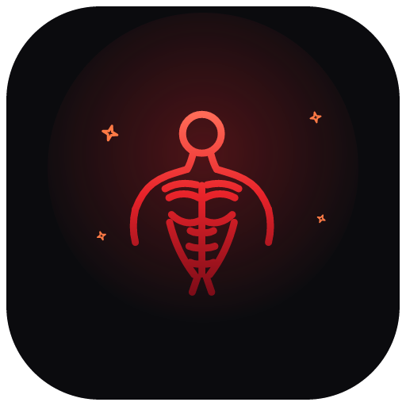

<p align="center">
  
</p>

<h1 align="center">EMBER — Keep the fire 🔥</h1>

<p align="center">
  App luyện tập cá nhân: <b>gym · chạy bộ · tiến trình</b> — local-first, offline, không tài khoản.<br/>
  A personal training PWA (gym + running + progress), local-first, offline-capable, zero cost.
</p>

<p align="center">
  
  
  
  
  
</p>

---

> *Mỗi buổi tập là một lần thổi lửa. Streak của bạn chính là ngọn lửa.*

## Tải về & cài đặt

| Nền tảng | Cách cài |
| --- | --- |
| 📱 **iPhone / iPad** | Mở **https://quanw12.github.io/ember/** bằng **Safari** → nút **Share** → **Add to Home Screen**. Icon nằm ở màn hình chính, chạy full màn hình, **offline** — không App Store, không chứng chỉ, không tái ký 7 ngày. |
| 🤖 **Android** | Mở link trên bằng **Chrome** → biểu tượng **Thêm vào Màn hình chính**. |
| 💻 **Laptop** (Win/Mac/Linux) | Mở link trên bằng **Chrome / Edge** → biểu tượng **Cài đặt** trên address bar — EMBER thành app desktop riêng. |
| 📦 **Bản phát hành** | Tải zip build sẵn tại [**Releases**](https://github.com/quanw12/ember/releases) (kèm `checksums.txt`), giải nén rồi chạy `npx serve .` hoặc `python -m http.server` trong thư mục đó. |

> Native iOS (IPA ký bằng Apple Developer, TestFlight) cần máy macOS + tài khoản $99/năm — vượt phạm vi build trên Windows. EMBER chọn PWA vì cài được thẳng lên iPhone ngay hôm nay với đầy đủ offline + notification.

## Tính năng

- 🔥 **Check-in hằng ngày**: một nút **THẮP LỬA** — không cần chụp ảnh; dải lửa 7 ngày gần nhất, streak gộp cả buổi tập lẫn check-in
- 🏋️ **Gym**: thư viện **876 bài tập** (hình minh họa + hướng dẫn + mức độ, nguồn mở free-exercise-db), lọc theo nhóm cơ/dụng cụ, log theo set với prefill lần trước, đồng hồ nghỉ tự động theo nhóm cơ, lịch sử + tiến độ + kỷ lục 1RM (Epley), ghim video TikTok/YouTube
- 🧍 **Mô hình người vẽ tay (SVG)**: 2 mặt trước/sau, chia nhóm cơ theo giải phẫu — bài tập nào nhóm cơ đó **sáng đỏ ember**; panel chọn bài tập kèm mô hình cơ mini từng bài
- 📋 **RCM kế hoạch**: chọn số buổi/tuần (2–6) → gợi ý lịch tương ứng (Full Body, Upper/Lower, PHUL, PPL, PPLUL) theo đúng trình độ, tạo & kích hoạt 1 chạm; tự soạn từng ngày cũng được
- 🏃 **Chạy bộ**: GPS vẽ đường real-time (OpenStreetMap), pace tức thời, lịch sử + split từng km, kế hoạch NHS Couch to 5K 9 tuần
- 📈 **Tiến trình**: cân nặng trung bình trượt 7 ngày, ảnh progress so sánh 2 mốc, kcal vs mục tiêu, giấc ngủ, chế độ nữ theo chu kỳ
- 🎯 **Onboarding mục tiêu** (cut/bulk/maintain/recomp): kcal + macro theo Mifflin-St Jeor + ISSN; kiểm tra chéo số buổi vs mức vận động để calo không tính lệch
- 🔔 **Nhắc nhở tử tế**: 1 thông báo/ngày, im khi đã tập; xuất .ics vào Apple Calendar
- 👥 **Đa hồ sơ**: mỗi người một kho IndexedDB riêng trên cùng máy — dữ liệu, kế hoạch, ảnh, backup tách biệt 100%
- 🔒 **Local-first**: không tài khoản, không server, chạy offline, backup/restore JSON, đơn vị kg/lb

## Chạy từ mã nguồn

```bash
git clone https://github.com/quanw12/ember.git
cd ember
npm ci
npm run icons   # sinh icon PNG cho manifest từ SVG brand
npm run dev     # http://localhost:5173
npm run build   # build production vào dist/
npm run test:smoke   # smoke test trình duyệt (cần Python + playwright)
```

Yêu cầu: Node 20+, npm. Smoke test: Python 3.10+ với `pip install playwright && playwright install chromium`.

## Cấu trúc

```
src/
  components/   MuscleFigure (mô hình cơ SVG), icons, TargetPhoto
  data/         seed bài tập, seed template kế hoạch, import thư viện
  lib/          tính calo/macro, RCM kế hoạch, lịch, GPS, nhắc nhở
  views/        Today, Gym (Plans/Library/Session/Detail), Run, Progress, Profile
  db.ts         Dexie — mỗi hồ sơ một DB IndexedDB riêng
```

## Deploy

Push vào `main` — GitHub Actions tự build và deploy lên **https://quanw12.github.io/ember/** (bật 1 lần: *Settings → Pages → Source: GitHub Actions*).

Push tag `v*` — workflow **Release** tự build, đóng gói zip + `checksums.txt` và tạo GitHub Release.

## License & credit

- License: **MIT** (xem [LICENSE](./LICENSE))
- Dữ liệu: thư viện bài tập [free-exercise-db](https://github.com/yuhonas/free-exercise-db) + [wger](https://wger.de), kế hoạch chạy [NHS Couch to 5K](https://www.nhs.uk/live-well/exercise/running-and-aerobic-exercises/get-running-with-couch-to-5k/), bản đồ [OpenStreetMap](https://www.openstreetmap.org)
- Disclaimer: EMBER không thay thế bác sĩ hay huấn luyện viên chuyên môn
