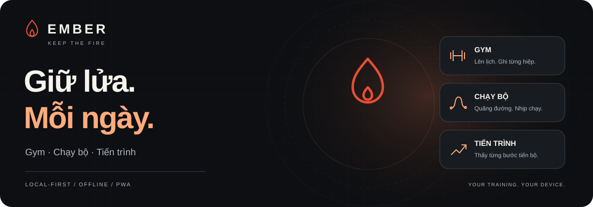
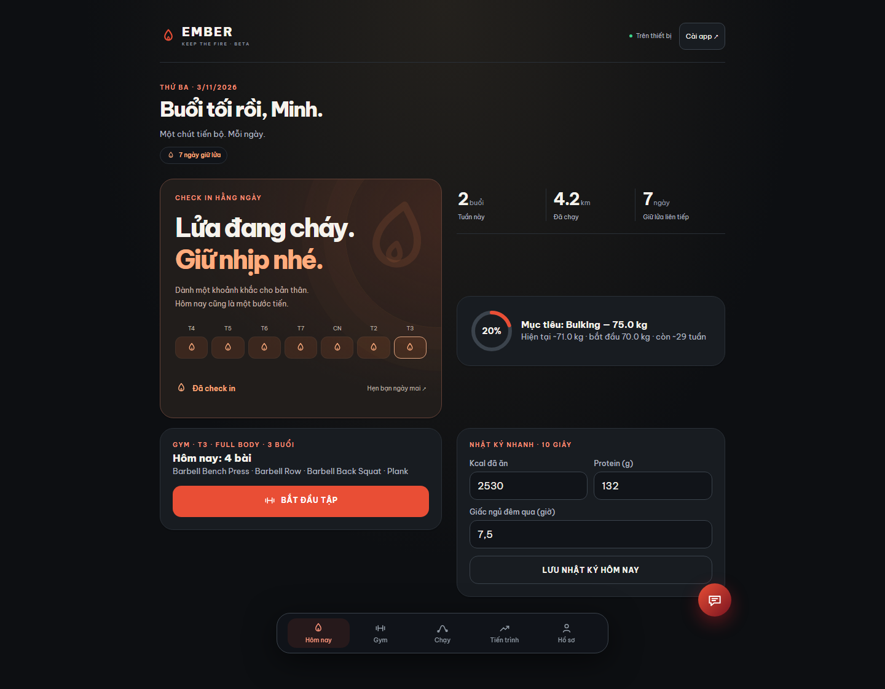
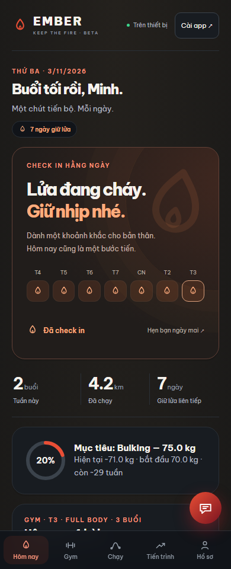
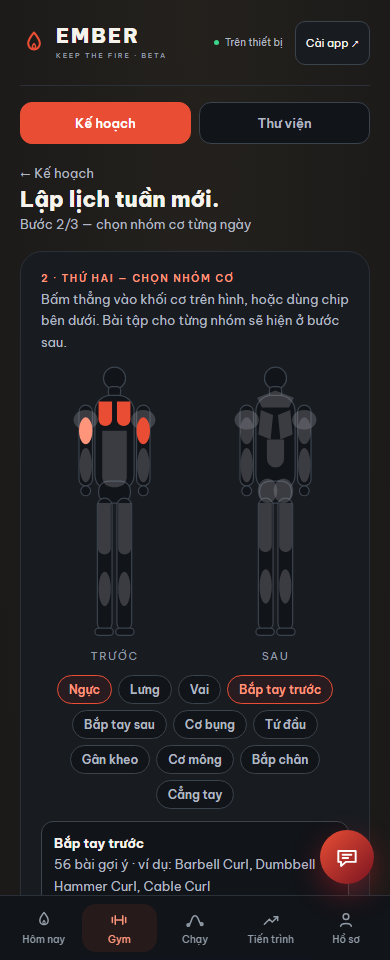
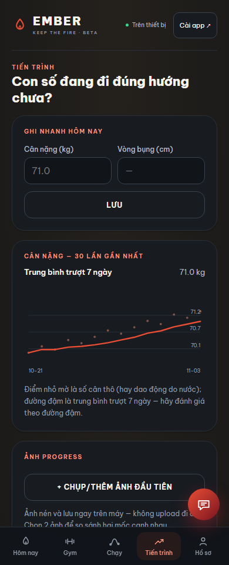
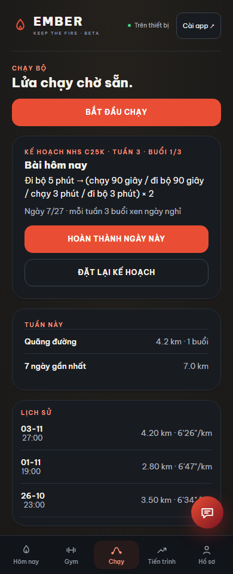
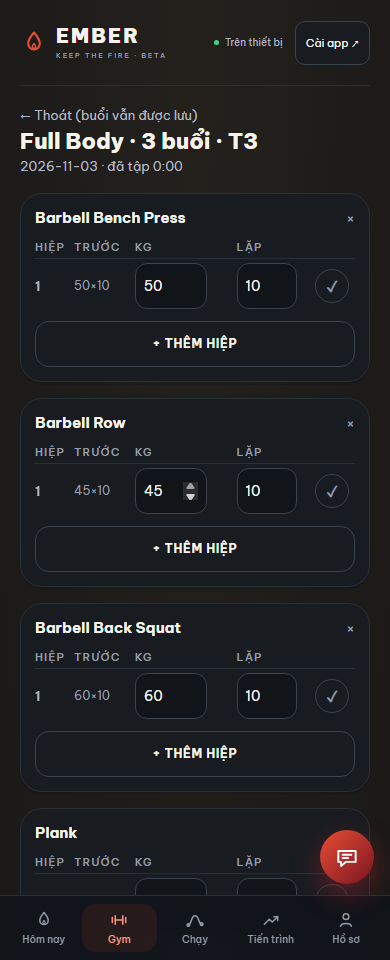
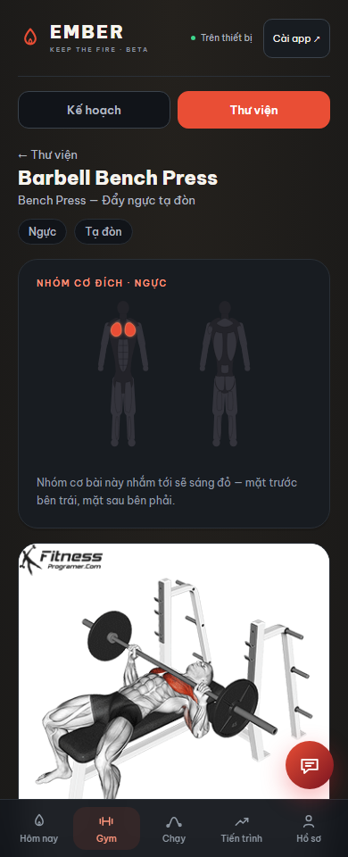
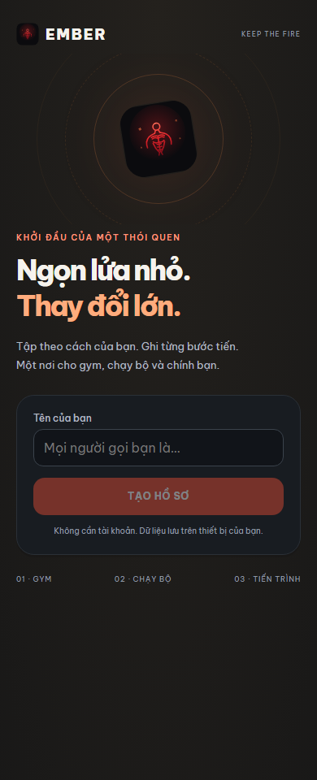
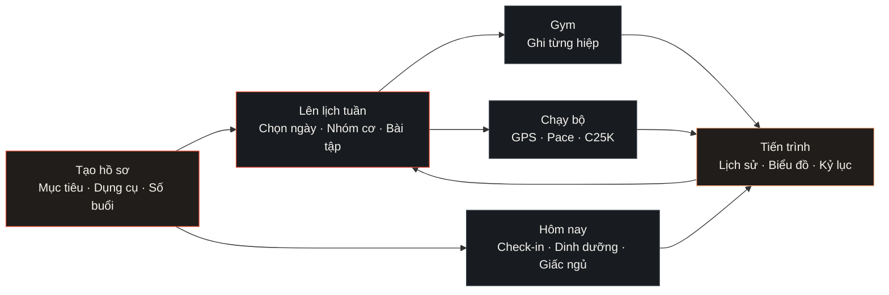

<p align="center">
  <picture>
    <source media="(prefers-color-scheme: dark)" srcset="docs/assets/cover-dark.svg">
    <source media="(prefers-color-scheme: light)" srcset="docs/assets/cover-light.svg">
    
  </picture>
</p>

<p align="center">
  <b>Một nơi cho buổi tập hôm nay và những tiến bộ ngày mai.</b><br>
  Nhật ký gym · Chạy bộ GPS · Theo dõi cơ thể · Không cần tài khoản
</p>

<p align="center">
  <a href="https://github.com/quanw12/ember/releases"></a>
  <a href="https://github.com/quanw12/ember/actions/workflows/deploy.yml"></a>
  
  
  <a href="LICENSE"></a>
</p>

<p align="center">
  <b><a href="https://quanw12.github.io/ember/">Mở app</a></b> &nbsp;·&nbsp;
  <b><a href="#cài-đặt">Tải APK / IPA</a></b> &nbsp;·&nbsp;
  <b><a href="#giao-diện">Giao diện</a></b> &nbsp;·&nbsp;
  <b><a href="#tính-năng">Tính năng</a></b> &nbsp;·&nbsp;
  <b><a href="#cài-đặt">Cài đặt</a></b> &nbsp;·&nbsp;
  <b><a href="#phát-triển">Mã nguồn</a></b>
</p>

---

## Vì sao có EMBER?

Một buổi tập nằm trong ghi chú, lịch chạy ở app khác, cân nặng lại ghi trong bảng tính. EMBER gom những việc đó vào cùng một nhật ký: chọn lịch, ghi từng hiệp, lưu buổi chạy và nhìn lại tiến trình.

Bạn có thể bắt đầu bằng một lần **THẮP LỬA**. Hồ sơ và nhật ký lưu trên thiết bị, không cần đăng ký tài khoản. Sau lần tải đầu có mạng, phần app đã được cache có thể mở offline.

## Giao diện

### Desktop



### Mobile

<table>
  <tr>
    <td align="center" valign="top" width="25%">
      
      <br><b>Hôm nay</b><br><sub>Giữ nhịp mỗi ngày.</sub>
    </td>
    <td align="center" valign="top" width="25%">
      
      <br><b>Lên lịch</b><br><sub>Chọn ngày và nhóm cơ.</sub>
    </td>
    <td align="center" valign="top" width="25%">
      
      <br><b>Tiến trình</b><br><sub>Thấy từng bước tiến.</sub>
    </td>
    <td align="center" valign="top" width="25%">
      
      <br><b>Chạy bộ</b><br><sub>Từ buổi đầu đến 5K.</sub>
    </td>
  </tr>
</table>

<details>
<summary><b>Xem thêm: buổi tập, thư viện bài tập và màn hình chào</b></summary>

<table>
  <tr>
    <td align="center" valign="top" width="33%">
      
      <br><b>Ghi từng hiệp</b><br><sub>Mức tạ, số lần lặp và dữ liệu buổi trước.</sub>
    </td>
    <td align="center" valign="top" width="33%">
      
      <br><b>Hiểu bài tập</b><br><sub>Nhóm cơ đích và động tác minh họa.</sub>
    </td>
    <td align="center" valign="top" width="33%">
      
      <br><b>Bắt đầu nhẹ nhàng</b><br><sub>Tạo hồ sơ, không cần tài khoản.</sub>
    </td>
  </tr>
</table>

</details>

<p align="center"><sub>Ảnh chụp trực tiếp từ app ở kích thước desktop và mobile, ngày 03/11/2026. Tên hồ sơ, cân nặng, lịch tập và lịch sử chạy là dữ liệu demo; ảnh mobile không phải ảnh chụp thiết bị vật lý. <a href="docs/screenshots/README.md">Cách chụp lại bộ ảnh</a>.</sub></p>

## Tính năng

| Bạn muốn làm gì? | EMBER hỗ trợ |
| --- | --- |
| **Giữ thói quen** | Check-in một chạm, lịch lửa bảy ngày, lịch tháng và streak tính cả gym, chạy bộ và check-in. |
| **Lên kế hoạch gym** | Gợi ý lịch 2–6 buổi theo trình độ và dụng cụ; chọn ngày, nhóm cơ và bài tập trên bản đồ cơ thể. |
| **Ghi buổi tập** | Mức tạ và số lần lặp theo từng hiệp, điền từ buổi trước, đồng hồ nghỉ và tổng kết cuối buổi. |
| **Tìm hiểu bài tập** | Thư viện mở gồm 876 bài từ free-exercise-db, bên cạnh bộ bài tuyển chọn; lọc nhóm cơ/dụng cụ, xem minh họa, hướng dẫn và ghim link video. |
| **Theo dõi sức mạnh** | Lịch sử bài tập, volume, mức tạ cao nhất và 1RM ước lượng theo Epley. |
| **Bắt đầu chạy** | GPS, lộ trình, thời gian, pace, split theo km và kế hoạch NHS Couch to 5K chín tuần. |
| **Nhìn lại cơ thể** | Biểu đồ cân nặng và trung bình trượt bảy ngày, vòng bụng, ảnh so sánh, kcal, protein và giấc ngủ. |
| **Đặt mục tiêu** | Cutting, bulking, duy trì hoặc recomp; ước tính năng lượng và macro từ thông tin hồ sơ. |
| **Dùng chung thiết bị** | Nhiều hồ sơ, mỗi hồ sơ một kho dữ liệu riêng. Có chế độ theo dõi chu kỳ. |
| **Giữ dữ liệu của mình** | Backup/restore JSON gồm ảnh và ngày giờ; không có máy chủ đồng bộ nhật ký. Coach gợi ý chạy cục bộ. |

## Cách app hoạt động



**Dữ liệu nằm ở đâu?** React hiển thị app; Dexie lưu nhật ký trong IndexedDB, tách theo từng hồ sơ. Bản web dùng service worker để cache phần app; bản APK/IPA đóng gói tài nguyên web bằng Capacitor. File JSON là bản backup do bạn giữ, có thể nhập lại để khôi phục hồ sơ. Bản web và app cài bằng APK/IPA có kho dữ liệu riêng.

**Những gì cần mạng:** lần tải đầu, ảnh bài tập hoặc ô bản đồ chưa cache và các link video ngoài. GitHub Pages phục vụ app; một số ảnh đến từ jsDelivr và bản đồ từ OpenStreetMap. Chi tiết ở [Quyền riêng tư](https://quanw12.github.io/ember/privacy.html).

## Cài đặt

EMBER có **APK cho Android**, **IPA chưa ký cho iPhone/iPad** và **bản web PWA**. APK/IPA hiện là bản thử nghiệm. Chọn cách cài phù hợp bên dưới; không cần tự build mã nguồn.

### Android — cài bằng APK

1. Mở [Android preview APK](https://github.com/quanw12/ember/actions/workflows/android-preview.yml), chọn lần chạy thành công có mã nguồn bạn muốn thử.
2. Trong **Artifacts**, tải `ember-android-debug` rồi giải nén để lấy `app-debug.apk`. GitHub yêu cầu đăng nhập để tải artifact; file được giữ trong 14 ngày theo cấu hình workflow hiện tại.
3. Mở file APK trên điện thoại. Nếu Android yêu cầu, cho phép ứng dụng đang mở file **cài đặt ứng dụng không rõ nguồn gốc**, sau đó chọn **Cài đặt**.
4. Mở **EMBER**, tạo hồ sơ hoặc khôi phục backup. Khi dùng tính năng chạy bộ, cấp quyền vị trí cho app.

Đây là APK debug. Nếu bản cập nhật báo không tương thích chữ ký, hãy **xuất backup JSON trước khi gỡ bản cũ**, rồi cài lại và khôi phục dữ liệu. Xem [chi tiết bản Android](docs/ANDROID.md).

### iPhone / iPad — cài bằng IPA

1. Mở [iOS unsigned IPA](https://github.com/quanw12/ember/actions/workflows/ios-sideload.yml), chọn lần chạy thành công có mã nguồn bạn muốn thử.
2. Trong **Artifacts**, tải `ember-ios-unsigned` rồi giải nén để lấy `ember-ios-unsigned.ipa`. Bạn cần đăng nhập GitHub; artifact được giữ trong 14 ngày.
3. Dùng công cụ sideload hỗ trợ ký IPA bằng **Apple Account của bạn**, làm theo hướng dẫn của công cụ để ký và cài lên iPhone/iPad. **IPA chưa ký không thể cài trực tiếp bằng cách mở file trong Safari hoặc Files.**
4. Hoàn tất các bước xác nhận trên thiết bị theo hướng dẫn của công cụ, rồi mở **EMBER** để tạo hồ sơ hoặc khôi phục backup.

Hãy kiểm tra thời hạn chữ ký trong công cụ sideload và tái ký khi cần. **Xuất backup trước khi tái ký hoặc gỡ app**; việc giữ dữ liệu phụ thuộc cách cài và bundle ID. Xem [chi tiết bản iOS](docs/IOS.md).

### Web / PWA — dùng ngay bằng trình duyệt

Mở **[quanw12.github.io/ember](https://quanw12.github.io/ember/)** để dùng ngay hoặc thêm vào màn hình chính:

| Thiết bị | Cách cài |
| --- | --- |
| **iPhone / iPad** | Mở link bằng **Safari** → **Chia sẻ** → **Thêm vào Màn hình chính**. |
| **Android** | Mở link bằng **Chrome** → menu **⋮** → **Cài đặt ứng dụng** hoặc **Thêm vào Màn hình chính**. |
| **Windows / macOS / Linux** | Mở bằng **Chrome / Edge** → chọn biểu tượng cài đặt trong thanh địa chỉ. |
| **Tự host** | Tải `ember-<version>-web.zip` trong [Releases](https://github.com/quanw12/ember/releases), giải nén và phục vụ thư mục bằng HTTP/HTTPS, ví dụ `python -m http.server 8080`. |

Với bản PWA, lần đầu hãy giữ mạng đến khi app báo **Sẵn sàng offline**. Trên điện thoại, phần **Cài app** ở đầu màn hình hướng dẫn thêm bản web vào màn hình chính.

### Chuyển dữ liệu giữa bản web, APK, IPA hoặc thiết bị khác

1. Trong bản đang dùng, vào **Hồ sơ → Xuất backup JSON** và lưu file ở nơi bạn có thể mở lại.
2. Mở bản mới, tạo hồ sơ nếu được yêu cầu, rồi vào **Hồ sơ → Khôi phục từ backup JSON** và chọn file vừa lưu.
3. Kiểm tra nhật ký, ảnh và lịch sử chạy đã có đủ trước khi xóa bản cũ.

Dữ liệu không tự đồng bộ giữa các bản hoặc thiết bị. Khi xuất backup bằng app native, hoàn tất thao tác lưu trong bảng chia sẻ và kiểm tra file đã được lưu.

### Ba bước đầu tiên

1. **Tạo hồ sơ.** Chọn mục tiêu, thông tin cơ thể và dụng cụ đang có.
2. **Chọn lịch.** Dùng lịch gợi ý trong tab Gym hoặc tự lập lịch tuần bằng bản đồ nhóm cơ.
3. **Bắt đầu ghi.** Mở Hôm nay để check-in, bắt đầu buổi tập hoặc ghi nhanh dinh dưỡng và giấc ngủ.

## Trạng thái beta và giới hạn

EMBER hiện có **PWA cài bằng link**, **APK Android thử nghiệm** và **IPA iOS chưa ký để sideload**. Các bản native được tải qua Actions như hướng dẫn trên; chưa phân phối qua Google Play/App Store.

- **Chạy bộ cần app ở phía trước và màn hình bật.** Bản này chưa cung cấp GPS nền đáng tin cậy khi khóa máy. Bản nháp lưu mỗi năm giây và có thể khôi phục sau khi tải lại.
- **Dữ liệu chưa tự đồng bộ giữa các máy.** Hãy xuất backup trước khi đổi thiết bị, xoá app hoặc xoá dữ liệu trình duyệt. Các hồ sơ trên cùng máy không phải tài khoản đăng nhập có mật khẩu.
- **Nhắc nhở chỉ chạy khi app mở.** Có thể xuất lịch `.ics` vào ứng dụng Lịch để nhận nhắc khi đóng app. Bản này chưa tích hợp Web Push nền.
- **Ảnh và bản đồ chưa tải cần mạng.** GIF minh họa được cache theo nhu cầu, không tải toàn bộ ở lần mở đầu.
- **Kiểm thử trình duyệt không thay thế máy thật.** Beta đã có kiểm tra Chromium/WebKit; vẫn cần thử cài đặt, quyền GPS, backup qua Files và cập nhật trên iPhone/Android vật lý.
- **Dữ liệu ảnh mới có định dạng mở rộng.** Không hạ về 0.2.1 trên cùng kho dữ liệu sau khi lưu ảnh bằng beta 0.3; bản cũ chưa đọc được ảnh dạng bytes.

Xem [báo cáo ổn định và phát hành](RELEASE-READINESS.md) để biết các lỗi đã sửa, phạm vi kiểm chứng và việc còn lại. Gợi ý luyện tập/dinh dưỡng của EMBER chỉ để tham khảo, không thay thế tư vấn chuyên môn.

## Phát triển

Các nhánh đang phát triển: [`feature/android-prototype`](https://github.com/quanw12/ember/tree/feature/android-prototype) cho APK, [`feature/ios-sideload`](https://github.com/quanw12/ember/tree/feature/ios-sideload) cho IPA chưa ký và [`feature/auth-local`](https://github.com/quanw12/ember/tree/feature/auth-local) cho tài khoản/máy chủ riêng. Hướng dẫn: [Android](docs/ANDROID.md), [iOS](docs/IOS.md), [tài khoản local](docs/ACCOUNTS.md). Đây là các thay đổi thử nghiệm, chưa thay thế bản PWA công khai.

Yêu cầu: **Node.js 22.12+ hoặc Node.js 24 LTS**, npm. Các lệnh dưới đây chạy từ thư mục gốc của repo.

```bash
git clone https://github.com/quanw12/ember.git
cd ember
npm ci
npm run dev
```

Mở địa chỉ Vite in ra trong terminal, mặc định là `http://localhost:5173`.

<details>
<summary><b>Build production, kiểm thử và chụp lại giao diện</b></summary>

```bash
# Typecheck + build PWA vào dist/
npm run build
npm run preview

# Sinh icon từ SVG nhận diện nếu thay logo
npm run icons
```

Kiểm thử dùng **Python 3.13** và Playwright:

```bash
pip install -r requirements-test.txt
python -m playwright install chromium webkit
npm run test:smoke
npm run test:release
```

`test:release` cần có bản `dist/` được build trước đó. CI Linux cài thêm dependencies hệ thống bằng `python -m playwright install --with-deps chromium webkit`.

Để chụp lại bộ ảnh README bằng Chromium và dữ liệu demo:

```bash
python scripts/with_server.py --server "npm run dev -- --port 5173 --strictPort" --port 5173 -- python scripts/capture_readme.py
```

Script tạo một browser context riêng, không đọc hồ sơ cá nhân đang lưu trong trình duyệt của bạn. Xem [ghi chú bộ ảnh](docs/screenshots/README.md).

</details>

### Kiểm chứng

| Kiểm tra | Nội dung |
| --- | --- |
| `npm run build` | TypeScript và build PWA production. |
| `npm run test:smoke` | Onboarding, hai hồ sơ và cách ly dữ liệu, check-in, log cân, lịch tập, thư viện và các tab. |
| `npm run test:release` | Chromium + WebKit, đường dẫn `/ember/`, bố cục 320–1440 px, backup ảnh/ngày giờ, GPS, pause/resume, khôi phục nháp và mở lại khi origin mất mạng. |
| `npm audit --omit=dev` | Kiểm tra dependencies production; cảnh báo trong chuỗi công cụ build được ghi riêng trong báo cáo phát hành. |

### Cấu trúc dự án

```text
src/
  components/     Bản đồ cơ, lịch lửa, Coach, thành phần giao diện
  data/           Bộ bài tập, thư viện mở, template gym và C25K
  lib/            Tính toán, GPS, backup, ảnh, gợi ý và nhắc nhở
  views/          Hôm nay, Gym, Chạy bộ, Tiến trình, Hồ sơ
  db.ts           IndexedDB/Dexie và quản lý nhiều hồ sơ
public/           Icon, dữ liệu bài tập, GIF, trang quyền riêng tư
scripts/          Tạo icon, kiểm thử và chụp ảnh README
docs/
  assets/         Cover SVG sáng/tối của README
  screenshots/    Ảnh chụp thật từ app với dữ liệu demo
.github/workflows/  CI, GitHub Pages và đóng gói release
```

### Deploy và release

Push vào `main` chạy build, kiểm thử trình duyệt và audit dependencies production trước khi deploy lên GitHub Pages. Cấu hình Pages với **Source: GitHub Actions**.

Tag `v*` tạo bản phát hành ZIP và `checksums.txt`. Tag có dấu `-`, ví dụ `v0.3.0-beta.1`, được đánh dấu **prerelease**. Bản beta nằm trong [danh sách Releases](https://github.com/quanw12/ember/releases).

APK và IPA được build riêng bằng workflow [Android preview APK](.github/workflows/android-preview.yml) và [iOS unsigned IPA](.github/workflows/ios-sideload.yml), lưu trong **Actions artifacts** trong 14 ngày. Workflow tag ở trên chỉ đóng gói bản web, không tự đính kèm APK/IPA vào Release. Hướng dẫn build native nằm trong [Android](docs/ANDROID.md) và [iOS](docs/IOS.md).

## Lộ trình

- [x] PWA cài qua link, giao diện desktop/mobile và hồ sơ riêng trên thiết bị.
- [x] Gym, chạy bộ, tiến trình, backup/restore ảnh và khôi phục buổi chạy.
- [x] Kiểm thử Chromium/WebKit và quy trình release tự động.
- [x] Đóng gói APK Android thử nghiệm và IPA iOS chưa ký qua Capacitor/GitHub Actions.
- [ ] Kiểm chứng beta trên nhiều iPhone và Android thật.
- [ ] Cải thiện trải nghiệm backup và chuyển dữ liệu giữa các máy.
- [ ] Cân nhắc đồng bộ theo lựa chọn của người dùng.
- [ ] Hoàn thiện bản native và chuẩn bị phân phối qua Google Play/App Store sau beta.

## Đóng góp

Báo lỗi hoặc đề xuất tại [GitHub Issues](https://github.com/quanw12/ember/issues). Với lỗi giao diện, gửi tên trình duyệt, thiết bị và các bước tái hiện. Với thay đổi mã nguồn, mô tả hành vi trước/sau và cách đã kiểm tra trong pull request.

Không đưa backup cá nhân, ảnh cơ thể hay lộ trình GPS vào issue công khai. Bộ ảnh trong README chỉ dùng dữ liệu demo.

## Nguồn và giấy phép

- **Mã nguồn EMBER:** [MIT](LICENSE), © 2026 quanw12.
- **Thư viện bài tập:** [free-exercise-db](https://github.com/yuhonas/free-exercise-db) và các nguồn được ghi trong dữ liệu/bài tập.
- **Kế hoạch chạy:** [NHS Couch to 5K](https://www.nhs.uk/live-well/exercise/running-and-aerobic-exercises/get-running-with-couch-to-5k/).
- **Bản đồ:** [OpenStreetMap](https://www.openstreetmap.org/copyright).
- **Nền tảng:** [React](https://react.dev/), [Vite](https://vite.dev/), [vite-plugin-pwa](https://vite-pwa-org.netlify.app/), [Dexie](https://dexie.org/) và [Leaflet](https://leafletjs.com/).
- **Font giao diện:** [Be Vietnam Pro](https://github.com/bettergui/BeVietnamPro).

<p align="center"><b>KEEP THE FIRE.</b><br><sub>Từng buổi tập. Từng bước chạy. Từng ngày giữ lửa.</sub></p>
